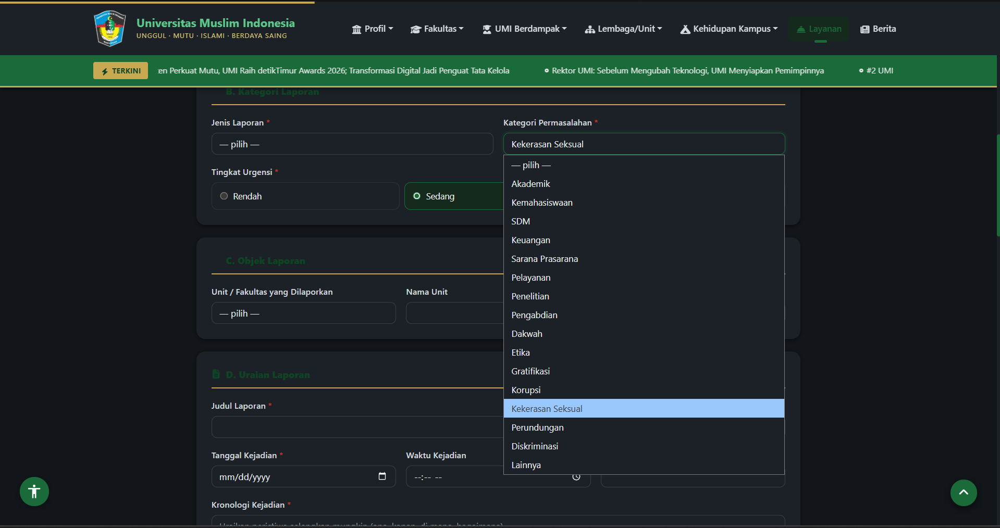

# Ringkasan Wawancara 01

- **Tanggal:** 21-10-2026
- **Responden:** mahasiswa semester 5
- **Pewawancara:** MUHAMMAD WIDYADHANA RAFIPUTRA
- **Layanan yang dibahas:** Layanan pengaduan dan pelaporan AMANAH: pengiriman laporan, penugasan ke unit, tindak lanjut, dan umpan balik

## Pertanyaan dan ringkasan jawaban
| Pertanyaan | Ringkasan jawaban |
|---|---|
| Apakah Anda mengetahui dan pernah membuka portal pengaduan AMANAH UMI (`umi.ac.id/amanah`)? | Mengetahui portal tersebut sebagai kanal aduan resmi kampus dan melihat bahwa formulirnya langsung terbuka untuk publik tanpa perlu login SSO terlebih dahulu. |
| Apa kendala yang Anda rasakan saat mengisi formulir pengiriman laporan di halaman AMANAH? | Cukup bingung membedakan 5 jenis laporan (Aspirasi, Pengaduan, Saran, Apresiasi, Permohonan Informasi) serta memilih dari 15 kategori masalah dan unit tujuan yang tepat. |
| Apa harapan Anda setelah berhasil mengirimkan laporan melalui formulir tersebut? | Ingin ada petunjuk singkat pada tiap kategori agar tidak salah pilih unit, serta mendapatkan konfirmasi yang jelas bahwa laporan dan kode tiket benar-benar sudah tercatat di sistem. |

## Temuan yang dipakai pada laporan
- A1: Konteks teknis dan bisnis layanan AMANAH sebagai formulir web publik tanpa login SSO yang membutuhkan kejelasan alur pengisian dan kepastian penerimaan tiket.
- A2: Kebutuhan pengguna akhir (mahasiswa) terhadap kemudahan pelaporan dan kepastian pencatatan laporan.
- B1: Identifikasi kandidat karakteristik *Usability* (kemudahan penggunaan) dan *Reliability* (keandalan pencatatan tiket).

## Bukti Tangkapan Layar Terkait

**Keterangan:** Tampilan antarmuka formulir publik AMANAH UMI (`https://umi.ac.id/amanah`) tanpa *login* SSO yang memuat 5 pilihan Jenis Laporan dan 15 pilihan Kategori Permasalahan. Tangkapan layar ini mendukung temuan wawancara **R1** mengenai perlunya panduan pengisian agar pelapor tidak salah memilih kategori dan unit tujuan, serta menjadi acuan analisis pada **BAB I**, **A1**, **A2**, dan **B1**.
