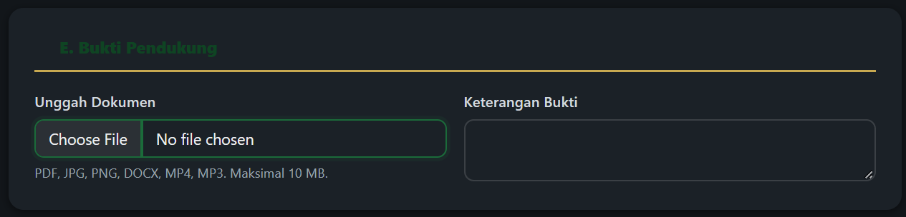

# Ringkasan Wawancara 03

- **Tanggal:** 22-10-2026
- **Responden:** mahasiswa semester 3
- **Pewawancara:** MUHAMMAD WIDYADHANA RAFIPUTRA
- **Layanan yang dibahas:** Layanan pengaduan dan pelaporan AMANAH: pengiriman laporan, penugasan ke unit, tindak lanjut, dan umpan balik

## Pertanyaan dan ringkasan jawaban
| Pertanyaan | Ringkasan jawaban |
|---|---|
| Apa kendala yang Anda temui terkait pengunggahan bukti pendukung pada formulir AMANAH? | Formulir mendukung banyak format (PDF, JPG, PNG, DOCX, MP4, MP3), namun batas ukuran maksimal 10 MB cukup menyulitkan untuk bukti video (MP4), ditambah risiko gagal unggah jika koneksi internet sedang lambat. |
| Bagaimana pengalaman Anda terkait cara melacak tindak lanjut laporan menggunakan kode tiket `AMANAH-XXXXXX` di halaman `/amanah/cek`? | Pelacakan dengan kode tiket mudah digunakan, tetapi sangat berisiko jika pelapor lupa menyimpan kode tiket tersebut setelah menutup halaman web. |
| Bagaimana seharusnya sistem memberi tahu perkembangan tindak lanjut laporan kepada pelapor? | Sistem sebaiknya mengirimkan salinan kode tiket `AMANAH-XXXXXX` dan notifikasi perubahan status secara otomatis ke Email atau WhatsApp (bagi pelapor non-anonim), sehingga tidak perlu mengecek halaman web berulang kali. |

## Temuan yang dipakai pada laporan
- A4: Perumusan ASR terkait keandalan pelacakan status, pengiriman notifikasi otomatis, dan penanganan unggahan berkas bukti maksimal 10 MB.
- A5: Penyusunan keputusan arsitektur (ADR) untuk penggunaan antrean pesan (*message queue*) pada pengiriman notifikasi status tiket serta pemisahan penyimpanan berkas bukti (*object storage*).
- B2: Perumusan atribut kualitas terukur untuk waktu respons unggah berkas bukti dan keandalan pengiriman notifikasi perubahan status tiket.

## Bukti Tangkapan Layar Terkait

**Keterangan:** Tampilan fasilitas unggah berkas bukti pendukung pada formulir AMANAH UMI yang membatasi ukuran lampiran maksimal 10 MB dengan format PDF, JPG, PNG, DOCX, MP4, dan MP3. Tangkapan layar ini mendukung temuan wawancara **R3** mengenai kendala ukuran unggahan video/dokumen dan keandalan proses unggah, serta menjadi acuan pada **A3**, **A4**, **A5**, dan **B2**.
