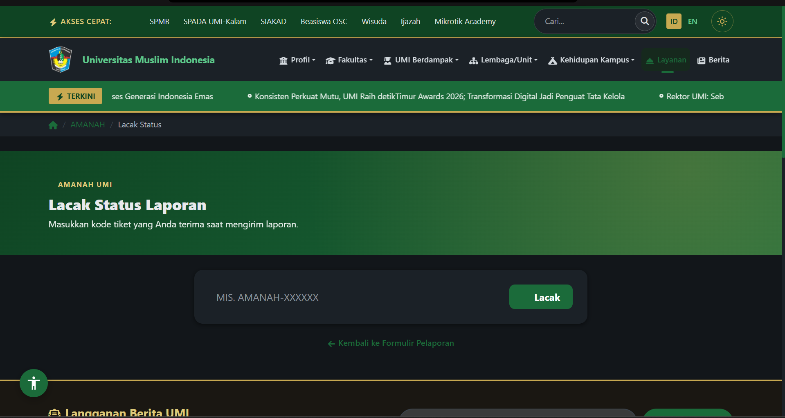

# Ringkasan Wawancara 04

- **Tanggal:** 22-10-2026
- **Responden:** staf admin pengelola layanan pengaduan
- **Pewawancara:** MUHAMMAD WIDYADHANA RAFI PUTRA
- **Layanan yang dibahas:** Layanan pengaduan dan pelaporan AMANAH: pengiriman laporan, penugasan ke unit, tindak lanjut, dan umpan balik

## Pertanyaan dan ringkasan jawaban
| Pertanyaan | Ringkasan jawaban |
|---|---|
| Bagaimana proses awal saat laporan dari sivitas akademika masuk ke dalam sistem pengaduan? | Admin harus memeriksa kelengkapan kronologi dan bukti pendukung, lalu memverifikasi apakah kategori permasalahan dan tingkat urgensi (Rendah, Sedang, Tinggi) yang dipilih pelapor sudah sesuai. |
| Apa kendala utama dalam proses penugasan (*disposisi*) laporan ke unit kerja atau fakultas terkait? | Pelapor sering salah memilih kategori atau unit objek laporan, sehingga admin harus mengalihkan penugasan secara manual; selain itu sulit memantau unit mana yang belum merespons laporan berurgensi Tinggi. |
| Fitur apa yang paling dibutuhkan pengelola agar laporan tidak menumpuk dan akuntabel? | Pencatatan riwayat perubahan status dan disposisi secara terpusat (*audit trail*), serta aturan alur penugasan yang mudah disesuaikan jika ada perubahan struktur unit kerja di kampus. |

## Temuan yang dipakai pada laporan
- A3: Identifikasi batasan operasional dan bisnis terkait keterbatasan jumlah personel admin pengelola dan keharusan mengikuti struktur birokrasi unit kerja kampus.
- A5: Penyusunan ADR terkait pencatatan riwayat status terpusat dan pemisahan data identitas sebelum laporan didisposisikan ke unit kerja.
- B5: Analisis *trade-off* antara pemeriksaan keamanan/verifikasi berlapis oleh admin dengan kecepatan waktu tanggap (*responsiveness*) penanganan laporan.

## Bukti Tangkapan Layar Terkait

**Keterangan:** Tampilan halaman pelacakan status laporan (`https://umi.ac.id/amanah/cek`) menggunakan kode tiket berformat `AMANAH-XXXXXX`. Tangkapan layar ini mendukung temuan wawancara terkait kebutuhan pencatatan riwayat perubahan status terpusat (*audit trail*) dan notifikasi otomatis kepada pelapor, serta menjadi acuan pada **A4**, **A5**, **B1**, dan **B5**.
