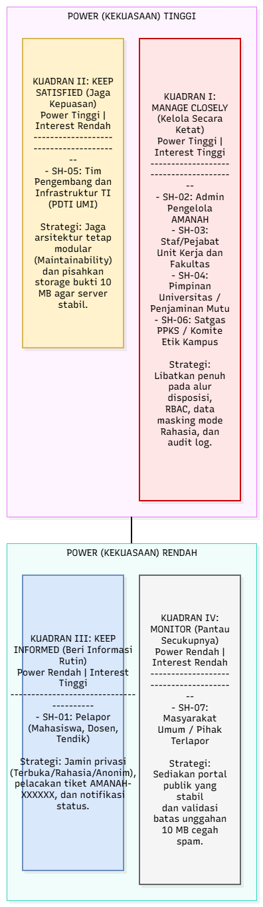
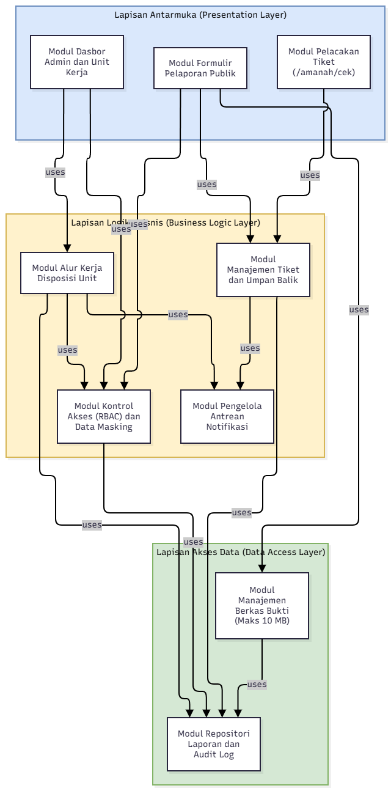
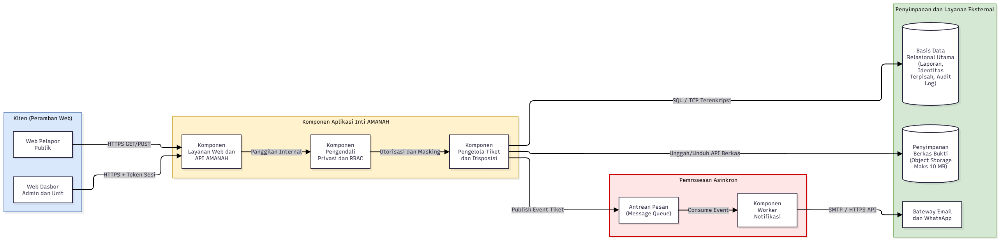
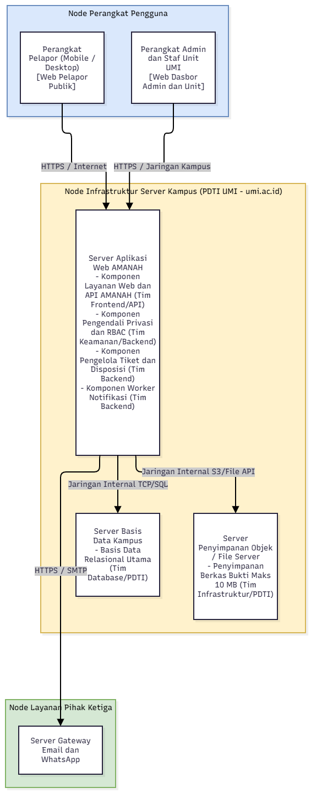

# Folder diagram

Simpan **dua berkas** untuk tiap diagram: berkas sumber (agar bisa diedit) dan gambar PNG (untuk laporan).

| Diagram | Berkas sumber (.drawio) | Gambar (.png) |
|---|---|---|
| **Peta power/interest (A2)** |  [A2-peta-power-interest.drawio](A2-peta-power-interest.drawio) |  |
| **Struktur modul (B3)** |  [B3-struktur-modul.drawio](B3-struktur-modul.drawio) |  |
| **Struktur C&C (B3)** |  [B3-struktur-cc.drawio](B3-struktur-cc.drawio) |  |
| **Struktur alokasi (B3)** |  [B3-struktur-alokasi.drawio](B3-struktur-alokasi.drawio) |  |

Commit setiap kali diagram berubah. Pesan commit contoh: `[B3] perbaiki konektor antara Layanan KRS dan Basis Data`.
