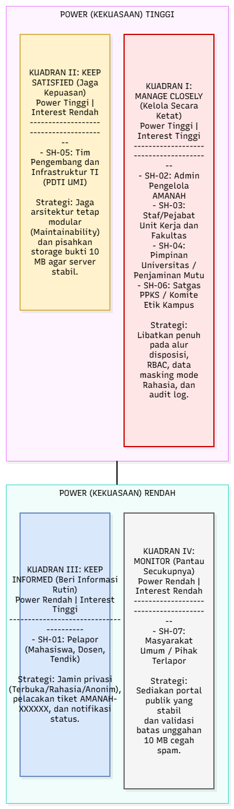

# A2. Stakeholder dan Peta Power/Interest

Penanggung jawab: Muhammad Widyadhana Rafi' Putra (@Kiano-Ksl)

## 1. Stakeholder Register Layanan AMANAH UMI

Tabel berikut mengidentifikasi 7 pemangku kepentingan (*stakeholder*) yang mewakili lima kelompok *stakeholder* wajib (pengguna akhir, tim pengembang, tim operasional, manajer bisnis, dan pihak eksternal) pada layanan pengaduan dan pelaporan **AMANAH UMI** (`https://umi.ac.id/amanah`), lengkap dengan kebutuhan utama, ekspektasi atribut kualitas, serta tingkat prioritasnya:

| Kode | Stakeholder | Kelompok Stakeholder | Kebutuhan Utama pada Sistem AMANAH | Ekspektasi Atribut Kualitas | Power (Kekuasaan) | Interest (Kepentingan) | Prioritas |
|---|---|---|---|---|---|---|---|
| **SH-01** | **Pelapor (Mahasiswa, Dosen, Tendik)** | Pengguna Akhir | Mengirim laporan pada 15 kategori masalah dengan pilihan mode *Terbuka, Rahasia,* atau *Anonim*, mengunggah bukti hingga 10 MB, dan melacak progres tiket `AMANAH-XXXXXX` di `/amanah/cek`. | *Security & Confidentiality* (kerahasiaan identitas), *Usability* (kemudahan pengisian), *Reliability* (kepastian kode tiket & notifikasi). | Rendah | Tinggi | Tinggi |
| **SH-02** | **Admin Pengelola AMANAH** | Tim Operasional | Memverifikasi kelengkapan laporan masuk, menyaring validitas bukti, menetapkan urgensi (*Rendah, Sedang, Tinggi*), dan mendisposisikan tiket ke unit kerja/fakultas yang tepat. | *Auditability/Traceability* (riwayat disposisi jelas), *Usability* (kemudahan manajemen antrean tiket), *Security* (kontrol akses). | Tinggi | Tinggi | Sangat Tinggi |
| **SH-03** | **Staf / Pejabat Unit Kerja & Fakultas Penerima Disposisi** | Tim Operasional | Menerima notifikasi penugasan laporan sesuai kewenangan unit, melakukan tindak lanjut (klarifikasi, mediasi, investigasi, perbaikan), dan memperbarui status penyelesaian tiket. | *Reliability* (keakuratan informasi disposisi), *Maintainability* (kemudahan alur pengalihan lintas-unit), *Performance* (akses bukti cepat). | Tinggi | Tinggi | Sangat Tinggi |
| **SH-04** | **Pimpinan Universitas / Penjaminan Mutu UMI** | Manajer Bisnis | Memantau rekapitulasi penyelesaian pengaduan lintas unit kerja, mengevaluasi waktu tanggap (*SLA*) tiap unit, serta menjaga akuntabilitas dan reputasi institusi kampus. | *Auditability* (ketertelusuran rekap laporan dan jejak audit), *Security & Integrity* (keaslian data laporan untuk pengambilan keputusan). | Tinggi | Tinggi | Sangat Tinggi |
| **SH-05** | **Tim Pengembang & Infrastruktur TI (PDTI UMI)** | Tim Pengembang | Mengembangkan dan memelihara modul aplikasi, mengelola basis data serta penyimpanan berkas bukti 10 MB, dan menjaga ketersediaan server pada domain `umi.ac.id`. | *Maintainability* & *Modularity* (kemudahan pembaruan kode tanpa *downtime*), *Performance Efficiency* (pengelolaan kapasitas penyimpanan bukti). | Tinggi | Rendah | Menengah |
| **SH-06** | **Satgas PPKS / Komite Etik & Disiplin Kampus** | Pihak Eksternal (Unit Khusus/Independen) | Menangani investigasi khusus untuk kategori laporan sensitif berurgensi tinggi (kekerasan seksual, perundungan, diskriminasi, korupsi, gratifikasi) dengan perlindungan saksi yang ketat. | *Security & Confidentiality* (jaminan mutlak kerahasiaan identitas pelapor dan keutuhan barang bukti video/dokumen). | Tinggi | Tinggi | Sangat Tinggi |
| **SH-07** | **Masyarakat Umum / Pihak Terlapor** | Pengguna Akhir / Pihak Eksternal | Mengajukan permohonan informasi publik melalui portal AMANAH (bagi masyarakat/mitra) atau memberikan klarifikasi resmi melalui unit terkait (bagi pihak terlapor). | *Availability* (ketersediaan akses portal publik 24/7), *Integrity* (objektivitas pencatatan tanggapan resmi). | Rendah | Rendah | Rendah |

---

## 2. Diagram Peta Power/Interest (Matriks Mendelow)

*(Berkas sumber diagram tersedia pada `diagram/A2-peta-power-interest.drawio` dan gambar pada `diagram/A2-peta-power-interest.png`)*

Pemetaan posisi ketujuh *stakeholder* ke dalam empat kuadran matriks *Power/Interest* beserta alasan penempatannya adalah sebagai berikut:

| Kuadran | Kategori Strategi | Daftar Stakeholder | Alasan Penempatan Posisi |
|---|---|---|---|
| **Kuadran I (Kanan Atas)** | **High Power, High Interest** *(Manage Closely / Kelola Secara Ketat)* | **SH-02** (Admin Pengelola AMANAH), **SH-03** (Unit Kerja/Fakultas Penerima Disposisi), **SH-04** (Pimpinan Universitas), **SH-06** (Satgas PPKS/Komite Etik) | Memiliki wewenang langsung dalam menentukan kebijakan, memverifikasi, menindaklanjuti, dan menutup laporan, sekaligus sangat berkepentingan terhadap keberhasilan operasional sistem AMANAH sehari-hari. |
| **Kuadran II (Kiri Atas)** | **High Power, Low Interest** *(Keep Satisfied / Jaga Kepuasan)* | **SH-05** (Tim Pengembang & Infrastruktur PDTI UMI) | Memiliki kewenangan teknis penuh atas infrastruktur server, keamanan jaringan, dan arsitektur basis data kampus, namun tidak terlibat langsung dalam urusan birokrasi penanganan isi aduan harian. |
| **Kuadran III (Kanan Bawah)** | **Low Power, High Interest** *(Keep Informed / Beri Informasi Rutin)* | **SH-01** (Pelapor: Mahasiswa, Dosen, Tendik) | Sangat berkepentingan agar laporannya ditindaklanjuti dengan cepat dan identitasnya aman, tetapi tidak memiliki wewenang struktural untuk mengubah alur internal sistem maupun mendisposisikan tiket. |
| **Kuadran IV (Kiri Bawah)** | **Low Power, Low Interest** *(Monitor / Pantau Secukupnya)* | **SH-07** (Masyarakat Umum / Pihak Terlapor) | Hanya berinteraksi secara insidental dengan sistem (misalnya untuk permohonan informasi umum) dan tidak memiliki kendali langsung atas pengelolaan sistem AMANAH. |

---

## 3. Strategi Pengelolaan Stakeholder pada Arsitektur

1. **Kuadran I – *Manage Closely* (High Power, High Interest — SH-02, SH-03, SH-04, SH-06):**
   Dilibatkan secara langsung dalam penetapan aturan alur kerja disposisi lintas-unit (**ASR-04**) dan kebijakan kontrol akses berbasis peran (**ASR-01** & **ADR-001**). Kebutuhan mereka dipenuhi melalui fitur penyamaran identitas otomatis (*data masking*) pada laporan *Rahasia*, pencatatan *immutable audit log* untuk memantau kinerja tindak lanjut unit kerja, serta pembatasan akses berkas bukti kasus sensitif khusus bagi petugas berwenang/Satgas terkait.
2. **Kuadran II – *Keep Satisfied* (High Power, Low Interest — SH-05):**
   Memastikan arsitektur yang dirancang tidak membebani operasional infrastruktur PDTI UMI. Strategi ini diwujudkan dengan merancang struktur kode yang modular (*Maintainability*), memisahkan penyimpanan berkas bukti 10 MB ke *object/file storage* agar basis data utama tidak cepat penuh (**ASR-03** & **ADR-002**), serta mendokumentasikan setiap keputusan teknis secara rapi melalui ADR di repositori GitHub.
3. **Kuadran III – *Keep Informed* (Low Power, High Interest — SH-01):**
   Menjaga kepercayaan pelapor melalui panduan formulir yang jelas, jaminan perlindungan privasi pada mode *Rahasia/Anonim* (**ASR-01**), serta penyediaan mekanisme pelacakan status yang transparan melalui kode tiket `AMANAH-XXXXXX` di `/amanah/cek` yang didukung antrean notifikasi otomatis setiap kali status laporan diperbarui oleh unit kerja (**ASR-02** & **ADR-002**).
4. **Kuadran IV – *Monitor* (Low Power, Low Interest — SH-07):**
   Menyediakan akses halaman publik yang stabil dan membatasi interaksi melalui validasi formulir serta pembatasan ukuran unggahan maksimal 10 MB guna mencegah penyalahgunaan (*spam/abuse*) tanpa perlu alokasi komunikasi khusus.
