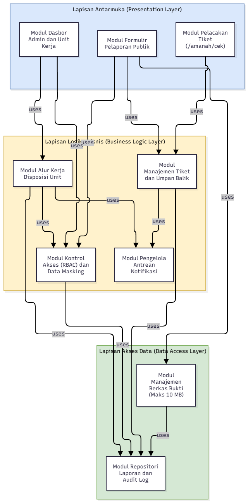
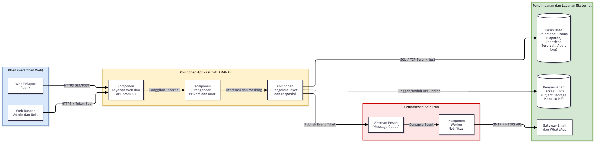
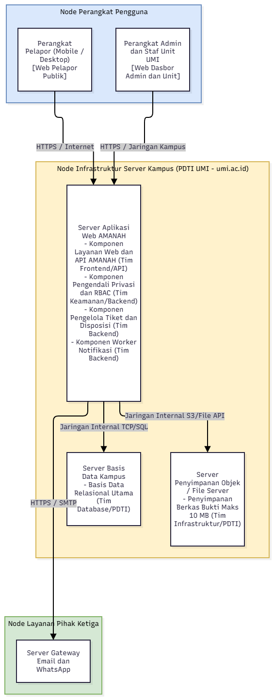

# B3. Tiga Struktur Desain Arsitektur

Penanggung jawab: Abrar Raynaldo Arifuddin (@Rayyy03) & Muhammad Widyadhana Rafi' Putra (@Kiano-Ksl)

Bagian ini memvisualisasikan perancangan arsitektur layanan pengaduan dan pelaporan **AMANAH UMI** melalui tiga struktur desain arsitektur perangkat lunak yang saling konsisten dan selaras dengan keputusan arsitektur pada **ADR-001** serta **ADR-002**.

## 1. Struktur Modul (*Module Structure*)

*(Berkas sumber: `diagram/B3-struktur-modul.drawio` | Gambar: `diagram/B3-struktur-modul.png`)*

Struktur modul di atas membagi basis kode sistem AMANAH ke dalam tiga lapisan utama (*Presentation Layer*, *Business Logic Layer*, dan *Data Access Layer*) dengan relasi ketergantungan searah ("menggunakan" / *uses*) untuk memenuhi karakteristik pendorong **Kemudahan Perawatan (*Maintainability*)**. Pemisahan tegas antara **Modul Manajemen Tiket dan Umpan Balik**, **Modul Alur Kerja Disposisi Unit**, serta **Modul Kontrol Akses (RBAC) dan Data Masking** memastikan bahwa perubahan aturan birokrasi disposisi atau penambahan kategori pengaduan baru di lingkungan UMI dapat dilakukan secara terisolasi tanpa merusak modul antarmuka maupun modul penyimpanan data. Seluruh akses ke basis data dan berkas bukti 10 MB wajib melewati **Modul Repositori Laporan dan Audit Log** serta **Modul Manajemen Berkas Bukti** agar aturan keamanan tetap terpusat.

## 2. Struktur Komponen dan Konektor (*Component and Connector / C&C Structure*)

*(Berkas sumber: `diagram/B3-struktur-cc.drawio` | Gambar: `diagram/B3-struktur-cc.png`)*

Struktur Komponen dan Konektor (C&C) menggambarkan interaksi waktu jalan (*runtime*) antarelemen sistem beserta protokol komunikasinya guna memenuhi karakteristik **Keamanan (*Security & Confidentiality*)** serta **Keandalan (*Reliability & Auditability*)**. Permintaan HTTP/HTTPS dari **Web Pelapor Publik** maupun **Web Dasbor Admin dan Unit** diterima oleh **Komponen Layanan Web dan API AMANAH**, lalu diverifikasi hak akses dan penyamaran identitasnya (*data masking* mode *Rahasia*) oleh **Komponen Pengendali Privasi dan RBAC** sesuai keputusan **ADR-001**. Untuk mencegah pelambatan (*bottleneck*) saat memproses unggahan bukti hingga 10 MB dan pengiriman notifikasi tiket `AMANAH-XXXXXX`, **Komponen Pengelola Tiket dan Disposisi** menyimpan berkas fisik secara terpisah ke **Penyimpanan Berkas Bukti (*Object Storage*)** dan menerbitkan peristiwa (*event*) ke **Antrean Pesan (*Message Queue*)** agar dikirim secara asinkron oleh **Komponen Worker Notifikasi** sesuai keputusan **ADR-002**.

## 3. Struktur Alokasi (*Allocation Structure*)

*(Berkas sumber: `diagram/B3-struktur-alokasi.drawio` | Gambar: `diagram/B3-struktur-alokasi.png`)*

Struktur alokasi memetakan penempatan komponen perangkat lunak ke dalam lingkungan fisik/infrastruktur server kampus (**Deployment View**) sekaligus membagi tanggung jawab pengembangannya ke subtim teknis (**Work Assignment**). Komponen aplikasi inti (**Komponen Layanan Web dan API AMANAH**, **Komponen Pengendali Privasi dan RBAC**, **Komponen Pengelola Tiket dan Disposisi**, serta **Komponen Worker Notifikasi**) dialokasikan pada **Server Aplikasi Web AMANAH** di bawah pengelolaan infrastruktur PDTI UMI (`umi.ac.id`), sedangkan **Basis Data Relasional Utama** dan **Penyimpanan Berkas Bukti (Maks 10 MB)** ditempatkan pada node penyimpanan terpisah di jaringan internal yang tidak terekspos langsung ke internet publik. Pembagian kerja dialokasikan secara spesifik antara Tim Frontend/API (antarmuka publik dan dasbor), Tim Keamanan/Backend (logika RBAC, disposisi, dan antrean notifikasi), serta Tim Database/Infrastruktur PDTI (basis data dan *object storage*).

## 4. Tabel Konsistensi Pemetaan Elemen Antarstruktur

Untuk menjamin konsistensi penamaan dan tanggung jawab di ketiga diagram, tabel berikut memetakan hubungan setiap elemen dari Struktur Modul, Struktur C&C, hingga Struktur Alokasi:

| Elemen pada Struktur Modul | Komponen Runtime pada Struktur C&C | Node Fisik & Tim pada Struktur Alokasi | Karakteristik & ADR Terkait |
|---|---|---|---|
| Modul Formulir Pelaporan Publik, Modul Pelacakan Tiket, Modul Dasbor Admin dan Unit Kerja | Web Pelapor Publik, Web Dasbor Admin dan Unit, Komponen Layanan Web dan API AMANAH | Perangkat Pelapor/Petugas & Server Aplikasi Web AMANAH (Tim Frontend/API) | *Usability*, *Availability* |
| Modul Kontrol Akses (RBAC) dan Data Masking | Komponen Pengendali Privasi dan RBAC | Server Aplikasi Web AMANAH (Tim Keamanan/Backend) | *Security & Confidentiality* (**ADR-001**, **ASR-01**) |
| Modul Manajemen Tiket dan Umpan Balik, Modul Alur Kerja Disposisi Unit | Komponen Pengelola Tiket dan Disposisi | Server Aplikasi Web AMANAH (Tim Backend) | *Maintainability*, *Auditability* (**ASR-04**) |
| Modul Pengelola Antrean Notifikasi | Antrean Pesan (*Message Queue*), Komponen Worker Notifikasi | Server Aplikasi Web AMANAH & Server Gateway Email/WA (Tim Backend) | *Reliability* (**ADR-002**, **ASR-02**) |
| Modul Repositori Laporan dan Audit Log | Basis Data Relasional Utama | Server Basis Data Kampus (Tim Database/PDTI) | *Security*, *Auditability* (**ADR-001**, **ASR-01**) |
| Modul Manajemen Berkas Bukti (Maks 10 MB) | Penyimpanan Berkas Bukti (*Object Storage*) | Server Penyimpanan Objek / File Server (Tim Infrastruktur/PDTI) | *Performance Efficiency*, *Reliability* (**ADR-002**, **ASR-03**) |
